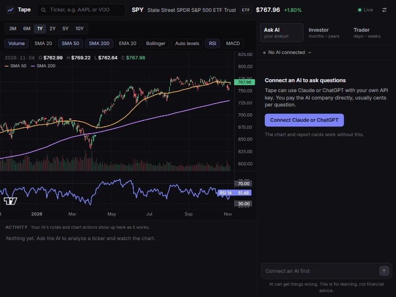

# Tape

A stock and ETF dashboard for learning how to evaluate US stocks. It runs on your own computer, and you can ask Claude or ChatGPT about what you're looking at while it draws on the chart.

## [Download Tape](https://github.com/arabmann1/tape/releases/latest/download/Tape.zip)

Less than 1 MB. You don't need a GitHub account.

## Getting started

1. **Unzip it.** On Windows, right-click the zip and choose *Extract All*. On a Mac, double-click the zip.
2. **Open it.** Windows: double-click `Start Tape`. Mac: right-click `Start Tape.command` and choose *Open*. Linux: run `./start-tape.sh` in a terminal.
3. **Wait a couple of minutes the first time.** It sets up a private copy of Python and the libraries Tape needs, using about 400 MB of disk space. You don't have to install anything.
4. **Connect an AI if you want one.** The chart and report cards work without it. For chat, paste your own Claude or ChatGPT API key in the app, and you pay that company directly, usually cents per question. A Claude Pro or ChatGPT Plus subscription doesn't include API use.

The zip includes `START-HERE.html`, a full guide to getting a key, costs and fixing problems.

Your computer may warn you the first time, because this app isn't from a big publisher. On Windows, click *More info*, then *Run anyway*. Only do this if you trust the person who sent you the link.

## Good to know

- **It's an early version.** It's been tested on Windows. The Mac and Linux starters are new and haven't been run on those systems yet.
- **Your data stays with you.** Your API key is saved on your computer and only ever sent to the company it belongs to. Your questions go to the AI you chose, and the tickers you look at are requested from Yahoo Finance. Nothing goes to anyone else, and Tape has no accounts or tracking.
- **This is a learning tool, not financial advice.** It describes what the data shows and won't tell you what to buy or sell. AI can make mistakes and market data can be wrong or late. Decisions, and any money you make or lose, are yours.

Tape comes with no warranty, and it isn't affiliated with Anthropic, OpenAI, Yahoo or TradingView. Third-party credits are in `NOTICE.txt`.

The files in this repository are the same ones that are in the download.
